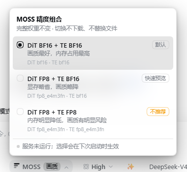
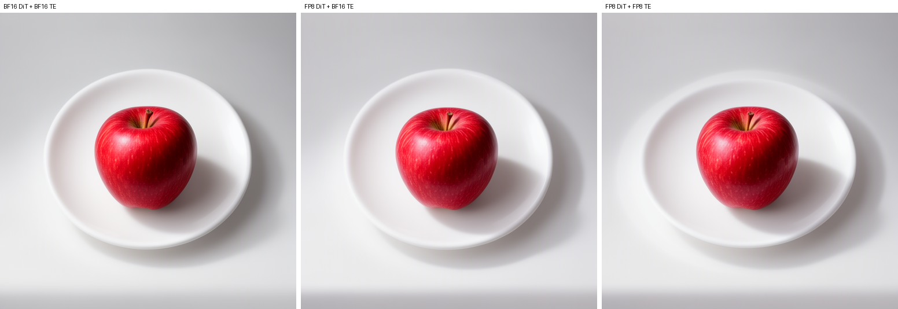

# dsh-moss-precision

DeepSeek Harness（DSH）插件：在输入框「推理等级」左侧增加一个 **MOSS** 下拉，手动切换
MOSS-Image 的三档精度组合。切换只改变加载精度，**不下载、不替换任何权重文件**。




## 功能

- 三档组合：`bf16-bf16`（默认）、`fp8-bf16`、`fp8-fp8`，不含 DiT FP16。
- 按钮位置：`conversation.input.right`，`order: -10`，紧贴在「推理等级」左侧。
- 选择状态由界面、CLI（`moss --precision`）与 Agent 工具 `moss_precision` 共享，
  持久化在 `<MOSS_ROOT>/state/precision.json`。
- 未选择过时自动使用 `bf16-bf16`；DiT 精度随每次请求生效，只有 Text Encoder
  精度变化时才重启本地 ComfyUI。
- 面板跟随 DSH 主题 token，中英文案跟随界面语言。

## 三档组合

| 档位 | DiT `weight_dtype` | Text Encoder 启动参数 | 说明 |
|---|---|---|---|
| `bf16-bf16`（默认） | `bf16` | `--bf16-text-enc` | 画质最好，内存占用最高 |
| `fp8-bf16` | `fp8_e4m3fn` | `--bf16-text-enc` | 显存略省，画质略降，用于快速预览 |
| `fp8-fp8` | `fp8_e4m3fn` | `--fp8_e4m3fn-text-enc` | 内存明显降低，画质有明显风险，不推荐 |

> FP8 变体需求里未指定。本实现取纯存储量化的 `fp8_e4m3fn`，不使用
> `fp8_e4m3fn_fast`（fp8 矩阵乘优化）。

## 工作原理

- **DiT**：精度写进每次请求的工作流（`MOSSImageHFLoader.weight_dtype`），不需要重启；
  bf16 完整权重在加载阶段转成 FP8。
- **Text Encoder**：ComfyUI 只能通过启动参数
  （`--bf16-text-enc` / `--fp8_e4m3fn-text-enc`）选择精度。插件在 TE 精度变化时
  停掉并重启 `<MOSS_ROOT>/start_service.py`，同一 TE 精度内换 DiT 不重启。
- **调用方契约**：生成请求由外部客户端（例如 `moss` CLI）提交。客户端必须读取
  `state/precision.json` 的 `level`，把对应 `dit_dtype` 写进工作流，并把组合 id 纳入
  幂等键；详见 [docs/DEPLOYMENT.md](docs/DEPLOYMENT.md#客户端契约)。
- **安全**：HTTP 路由只服务 loopback，校验 `Host`/`Origin`/`sec-fetch-site`，
  写操作要求 `x-dsh-moss-precision: 1` 与 `application/json`。

## 环境要求

| 项 | 要求 |
|---|---|
| DSH | 桌面版 0.2.1-rc.2 实测通过；需要支持 `dsh.client` bundle 与 `webServer` 服务的版本 |
| 操作系统 | Windows 10/11 x64 实测；Linux/macOS 未验证（默认用 `venv\Scripts\python.exe`） |
| ComfyUI | 可运行的 MOSS-Image 部署，含官方 `moss-image` 自定义节点 |
| Python | 部署自带 venv（实测 3.12.15），`psutil`、`torch` 由 ComfyUI 环境提供 |
| 显存 | 8 GB 笔记本显卡实测可用（`--lowvram`） |
| 生成客户端 | 一个能提交 MOSS-Image 工作流的客户端；本仓库不包含生成客户端 |

## 安装

> **发布状态**：本仓库**未发布**到 npm 或 DSH 插件市场。当前支持两种安装方式：
> 在「插件 → 添加插件」中输入**本仓库的 GitHub 地址**，或输入**本地目录路径**。

### 1. 部署服务端精度层

把 [`server/moss_precision.py`](server/moss_precision.py) 复制到 MOSS 部署的
`tools/` 目录（必须放在这里，脚本用 `tools/` 的父目录作为部署根）：

```bat
copy server\moss_precision.py "<MOSS_ROOT>\tools\moss_precision.py"
```

然后按 [docs/DEPLOYMENT.md](docs/DEPLOYMENT.md) 完成：

1. `start_service.py` 支持 `--text-enc`；
2. `custom_nodes/moss-image` 的两处 FP8 修正（否则 `--fp8_e4m3fn-text-enc` 不生效）；
3. 生成客户端按契约读取 `state/precision.json`。

验证服务端：

```bat
"<MOSS_ROOT>\venv\Scripts\python.exe" "<MOSS_ROOT>\tools\moss_precision.py" --status
```

### 2. 配置部署根目录

任选其一：

- 环境变量 `MOSS_ROOT`（推荐）：`setx MOSS_ROOT "<MOSS_ROOT>"`；
- 或在本插件目录创建 `config.local.json`（已被 `.gitignore` 排除，不会入库；
  `X:` 换成你的盘符）：

```json
{ "root": "X:\\moss" }
```

Python 解释器默认取 `<MOSS_ROOT>\venv\Scripts\python.exe`，可用 `MOSS_PYTHON` 覆盖。

### 3. 安装插件

1. 打开 DSH 的「插件」页 → **添加插件**；
2. 输入本仓库的 GitHub 地址（或 clone 后的本地目录路径）；
3. 点「安装」，等待 bundle 激活；
4. 刷新一次页面（`Ctrl+R`），输入框工具栏出现 **MOSS** 按钮。

本地开发时也可以直接安装目录：在「添加插件」里填绝对路径即可。

### 4. 验证

- 按钮显示当前档位（如 `MOSS 画质`）；
- 展开后能看到三档与「服务未运行 / 服务运行中 · 实际 TE …」状态行；
- 宿主路由：`GET http://127.0.0.1:<DSH端口>/api/moss-precision/state` 返回 JSON。

## 使用

### 界面

点 **MOSS** → 选择一档。切换中按钮显示「切换中…」；涉及 Text Encoder 时会重启
ComfyUI（约 1–2 分钟），面板底部会说明是否需要重启。

### 命令行

```bat
moss --precision fp8-bf16
moss "快速预览" --precision fp8-bf16
moss --status
```

`--precision` 只写 `bf16-bf16` / `fp8-bf16` / `fp8-fp8`；不带提示词时只切换、不生成。
（需要部署侧的 `moss` CLI 已按契约集成；见 docs/DEPLOYMENT.md。）

### Python

```bat
python "<MOSS_ROOT>\tools\moss_precision.py" --set fp8-fp8
python "<MOSS_ROOT>\tools\moss_precision.py" --status
```

### Agent 工具

插件注册了 `moss_precision`（`action: get | set`），与界面共用同一实现。`set` 只负责
启动切换并立即返回，之后用 `action: get` 查看是否已生效。

## 可配置项

| 项 | 默认 | 说明 |
|---|---|---|
| `MOSS_ROOT` | 无（必填其一） | MOSS-Image 部署根目录 |
| `config.local.json` | 无 | `{"root": "..."}`，git-ignored 的本机配置 |
| `MOSS_PYTHON` | `<MOSS_ROOT>\venv\Scripts\python.exe` | 精度脚本使用的解释器 |
| `moss_precision.py --no-restart` | 关 | 需要重启时不重启，直接失败并回滚 |

插件本身没有 Loader Config schema；以上环境变量/文件即全部可配置项。

## 测试结果

以下数据来自 2026-10-20 在本机的独立复核。原始数据：
[`docs/data/verification.json`](docs/data/verification.json)、
[`docs/data/quality-apple-metrics.json`](docs/data/quality-apple-metrics.json)、
[`docs/data/quality-text-metrics.json`](docs/data/quality-text-metrics.json)。

**测试条件**：RTX 5060 Laptop 8 GB（8151 MiB）；512×512；8 步；seed 42 / 43；
两个固定提示词；每档独立启动一个 ComfyUI 进程（`--lowvram --disable-async-offload
--bf16-unet --<te>-text-enc`）；外部每 0.5 s 采整卡显存与进程 RSS；“冷”＝新进程
第一次生成（含模型加载），“热”＝同进程第二次生成；显存为整卡已用峰值（含约
1.4 GiB 桌面占用），RSS 为工作集，生成后再等 6 s 取值。

### 资源

| 档位 | 峰值显存（冷，MiB，各次） | 冷峰值 RSS（GiB，各次） | 生成后 RSS（GiB，各次） | 同 seed 输出 SHA-256（seed 42 / 43） |
|---|---|---|---|---:|
| `bf16-bf16` | 7406 / 7392 → 均值 7399 | 21.28 / 23.72 | 19.94 / 20.94 | `b74772e4…` / `fab9d76d…` |
| `fp8-bf16` | 6757 / 6747 → 6752 | 23.73 / 23.08 | 21.29 / 20.93 | `2c989921…` / `f27cd48c…` |
| `fp8-fp8` | 6756 / 6747 / 6779 → 6761 | 23.62 / 23.15 / 23.85 | 21.49 / 21.48 / 21.38 | `c56e462e…` / `7968a879…` |

- **显存**：DiT BF16 → FP8 冷峰值降低约 **647 MiB（8.7%）**，档内波动 ≤32 MiB，
  可重复；`fp8-bf16` 与 `fp8-fp8` 的差（9 MiB）落在噪声内，**TE 档位不影响显存**
  （TE 在 CPU 上）。`--lowvram` 下 DiT 按块搬运，所以收益远小于权重体积的一半。
- **常驻内存**：三档没有可复现差异。档间均值差约 0.7–1.0 GiB，但 `bf16` 自己
  两轮就漂移 2.4 GiB，且排序会翻转；**不能得出 FP8 更省内存的结论**。
- **dtype**：日志显示 DiT 在 FP8 档为 `torch.float8_e4m3fn`（manual cast bf16），
  TE 在第三档为 `torch.float8_e4m3fn`。但服务进程内 `parameters()` 观测到 DiT
  462 个参数全部为 bf16、TE 只有 25 个保持 fp8（470 bf16、265 fp32）；FP8 的
  存储保留不完整，具体保留层未逐层枚举（不确定）。
- **权重**：25 个文件，测量前后 size + mtime 全部一致。

### 画质

同 seed 的三档输出互不相同，且干净进程内/跨进程可复现：

- 简单物体（苹果，seed 42）：BF16 vs FP8 DiT `PSNR 30.49 dB / SSIM 0.982`；
  FP8 DiT vs FP8 双 `31.46 / 0.975`；BF16 vs FP8 双 `28.91 / 0.965`。
  并排观察几乎一致，差异表现为细节/高光位移，没有局部崩坏。
- 文字压力测试（「今日咖啡」，20 步，seed 42）：三档四个字全部正确、笔画完整；
  FP8 DiT vs FP8 双 `30.14 / 0.968`；BF16 vs FP8 DiT 的 `19.95 / 0.800` 主要来自
  构图/机位变化，不是文字质量下降。




**结论**：像素差异真实存在；在本次两个提示词上没有观察到可辨的“画质下降”。
差异更像同一提示词的重新采样（构图、笔触、高光位置），而不是模糊、噪点或错字。

### 覆盖与未覆盖

- 已覆盖：三档、2 个提示词、2 个 seed、512×512、8/20 步；dtype 日志与进程内观测；
  整卡显存、进程 RSS、输出 SHA、权重完整性；同进程 A→B→A 确定性对照。
- 未覆盖：其他分辨率/步数/模型；多人、密集小字、极细纹理；Linux/macOS；
  其他显卡；逐进程显存（本机 WDDM 下 nvidia-smi 返回 `[N/A]`）；盲评/多人评审；
  长时间连续运行的稳定性。
- 异常：8 次冷启动生成中有 1 次（`fp8-fp8`）首次加载报
  `HostBuffer.read_file_slice failed`；该进程之后仍能生成，但同 seed 输出与干净
  进程不同。遇到加载报错后应重启服务，不要沿用该进程。

## 已知限制与注意事项

1. **TE FP8 不省内存**：加载时按 fp8 构建，但运行时大部分权重被 ComfyUI 转回
   bf16/fp32，只有 25 个参数保持 fp8；实测 RSS 没有下降。选型时不要把
   `fp8-fp8` 当作“省内存档”。
2. **显存收益有限**：`--lowvram` 下 DiT 按块搬运，FP8 只降低约 650 MiB 峰值。
3. **输出不是逐像素一致**：FP8 档会改变构图/细节；需要严格复现或交付级结果时用
   `bf16-bf16`。
4. **依赖节点补丁**：不应用 `docs/DEPLOYMENT.md` 的两处修正时，
   `--fp8_e4m3fn-text-enc` 会被检查点 dtype 覆盖，第三档与第二档等价。
5. **仅 Windows 实测**；脚本路径默认 `venv\Scripts\python.exe`。
6. **未发布 npm / 插件市场**；包名 `@local/dsh-moss-precision` 是本地 bundle 名，
   直接 npm 发布需要改名与 registry 凭据。
7. 插件通过 DSH 的 `webServer` 暴露本机路由；只绑定 loopback，并做 Host/Origin
   校验。与其它本地插件同一信任模型：能访问本机回环的进程即可调用。

## 许可证

[MIT](LICENSE)

## 反馈

请在 GitHub 仓库的 Issues 中反馈（仓库地址待补充）。提交问题时请附上：

- DSH 版本、插件版本、ComfyUI/`moss-image` 版本；
- `moss_precision.py --status` 输出；
- `logs/comfyui.log` 中相关时间段的 `model weight dtype` / `CLIP/text encoder`
  行（自行脱敏本地路径）。
